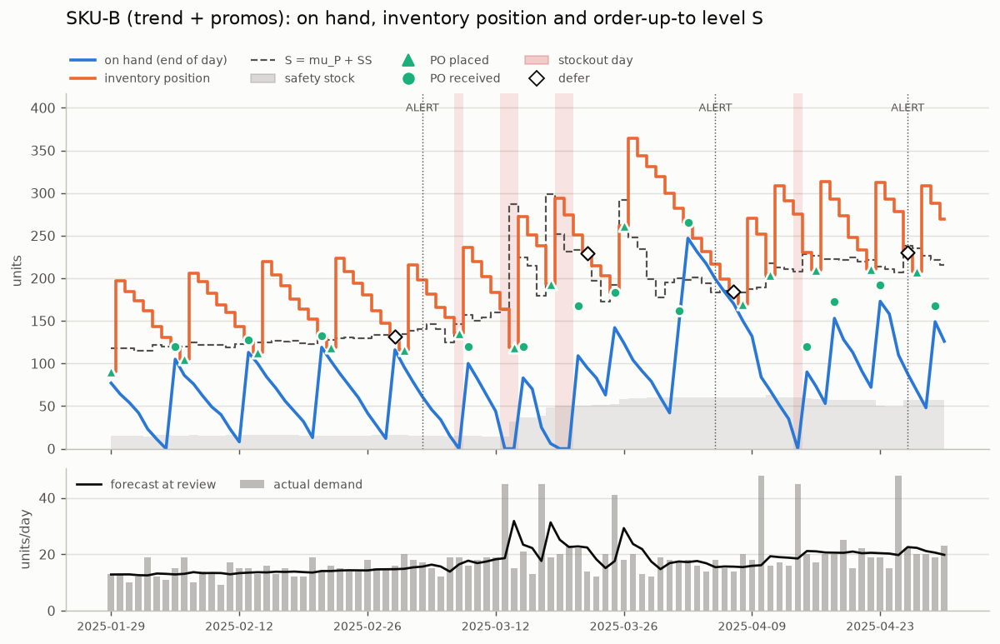

# Inventory replenishment agent

[](https://colab.research.google.com/github/minchree/inventory-replenishment-agent/blob/main/notebooks/InventoryReplenishmentAgent.ipynb)

An agent that decides every day, for each SKU, whether to order, hold, or wait. It forecasts demand with EWMA, sets safety stock from its own forecast error, and checks inventory position against an order-up-to level over the lead time plus one review day. Waiting is priced: the agent defers an order only when the expected shortage cost of waiting a day is below the holding cost it saves. It also watches its forecast for bias and logs an ALERT when it adapts. Every line of the daily log is rendered from the numbers behind the decision.

Built for the SJSU Applied AI inventory replenishment assignment, starting from the course starter notebook ([myrah/AAI2025](https://github.com/myrah/AAI2025/blob/dev/aai/InventoryReplenishmentAgent.ipynb)).

| document | what's in it |
|---|---|
| [Design document](docs/DESIGN_DOCUMENT.md) | one page: goal, inputs and outputs, guardrails, metrics, ethics and trust |
| [Trade-offs](docs/TRADE_OFFS.md) | inventory against service, from the service-level sweep |
| [Scaling note](docs/SCALING.md) | half a page: deployment, monitoring, reliability, cost controls |
| [Assignment checklist](docs/COMPLIANCE.md) | where every rubric line lives |
| [Starter audit](docs/STARTER_AUDIT.md) | seven defects in the course starter, each confirmed by a test |
| [Technical design](docs/DESIGN.md) | conventions, formulas, design iterations, hand-worked trace |
| [Grader Q&A](docs/DEFENSE.md) | ten questions about the design, answered from this repo |

## Results

The notebook runs in Colab with **Runtime > Run all**. These tables are generated by `python -m replenish evaluate` and copied in by `python -m replenish readme`. P3 is the full agent. Monte Carlo results use held-out demand seeds that played no part in the design.

<!-- results:start -->
**Committed CSVs, all SKUs, 92 simulated days (K = 0)**

| policy | fill rate | stockout days | units short | holding $ | stockout $ | relevant $ | POs |
|---|---|---|---|---|---|---|---|
| P0 starter (s,Q) | 0.810 | 67 | 1043 | 797.22 | 15,308.50 | 16,105.72 | 81 |
| P1 naive agent | 0.982 | 9 | 100 | 3,787.48 | 855.00 | 4,642.48 | 75 |
| P2 EWMA textbook | 0.990 | 4 | 53 | 1,906.32 | 1,325.00 | 3,231.32 | 82 |
| P3 full agent | 0.986 | 9 | 77 | 1,868.14 | 1,959.50 | 3,827.64 | 81 |
| P4 clairvoyant | 1.000 | 0 | 0 | 1,057.28 | 0.00 | 1,057.28 | 77 |
| P3 without defer | 0.990 | 4 | 53 | 2,007.12 | 1,325.00 | 3,332.12 | 81 |
| P3 without reflect | 0.988 | 8 | 67 | 1,802.34 | 1,709.50 | 3,511.84 | 82 |

**200 demand paths, all SKUs: mean (5th-95th percentile)**

| policy | fill rate | stockout days | relevant $ |
|---|---|---|---|
| P0 starter (s,Q) | 0.842 (0.792-0.882) | 54.6 | 14,046 (11,029-17,433) |
| P1 naive agent | 0.978 (0.962-0.990) | 8.6 | 4,512 (3,712-5,415) |
| P2 EWMA textbook | 0.990 (0.980-0.997) | 5.1 | 3,092 (2,208-4,314) |
| P3 full agent | 0.987 (0.977-0.996) | 6.3 | 3,222 (2,175-4,528) |
| P4 clairvoyant | 0.997 (0.991-1.000) | 1.5 | 1,530 (1,091-2,264) |
| P3 without defer | 0.990 (0.980-0.997) | 5.1 | 3,137 (2,195-4,332) |
| P3 without reflect | 0.988 (0.977-0.996) | 6.1 | 3,133 (2,126-4,338) |

**Paired comparison on the same demand paths (relevant cost, all SKUs)**

| comparison | mean difference $ | 5th-95th pct | paths where P3 is cheaper |
|---|---|---|---|
| P3 full agent vs P2 EWMA textbook | +130 | -312 to +870 | 48% |
| P3 full agent vs P3 without defer | +84 | -219 to +647 | 57% |
| P3 full agent vs P3 without reflect | +89 | -428 to +650 | 33% |
| P3 full agent vs P0 starter (s,Q) | -10,825 | -14,365 to -7,866 | 100% |
| P3 full agent vs P1 naive agent | -1,291 | -2,041 to -96 | 96% |

**Safety stock and the cost check, per SKU (full agent, first simulated day)**

| SKU | demand class | alpha | L | SL | z | sigma_1 | SS | S | CSL* | what the costs say | predicted fill | achieved fill |
|---|---|---|---|---|---|---|---|---|---|---|---|---|
| SKU-A | smooth | 0.1 | 3 | 0.95 | 1.64 | 10.55 | 34.7 | 175.2 | 0.980 | costs favour more protection | 0.994 | 0.999 |
| SKU-B | smooth | 0.1 | 7 | 0.98 | 2.05 | 2.65 | 15.4 | 117.9 | 0.973 | aligned | 0.999 | 0.960 |
| SKU-C | intermittent | 0.1 | 10 | 0.98 | 2.05 | 1.87 | 12.7 | 20.4 | 0.847 | costs favour less protection | 0.998 | 0.951 |
<!-- results:end -->



What the numbers say:

- The full agent cuts relevant cost by about $10,800 per path against the starter's static (s,Q) policy and by about $1,300 against a naive-forecast agent, and is cheaper on 100% and 96% of paths.
- Against the textbook EWMA agent it is a tie. The mean difference is +$130, inside a 5th-95th percentile range of -$312 to +$870, and P3 is cheaper on 48% of paths.
- The defer rule pays on the intermittent SKU-C, saving $56 per path and winning on 82% of paths, because its 24-unit minimum order covers about 15 days of demand. It loses $139 per path on the promo-driven SKU-B, where a normal model understates how hard a promo day hits.
- The reflect step stays silent on SKU-A, is off by design on SKU-C, and costs $89 per path on SKU-B.
- The cost check (CSL*) picked SKU-A's cheapest service level exactly (0.98 against a configured 0.95) and pointed the right way for SKU-C. It missed for SKU-B for the same promo-tail reason.

## How the agent decides

Each day, for each SKU, in this order:

1. Receive the POs due today.
2. Review. Inventory position IP = on hand + on order − backorders. The forecast has seen demand only through yesterday. With lead time L and a daily review, today's IP has to cover L + 1 days, so the protection interval is P = L + 1.
3. Compute safety stock from forecast error: sigma_P = sigma_1 × √P, where sigma_1 is the RMSE of the last 28 one-step forecast errors, and SS = z × sigma_P with z from `service_level`. The order-up-to level is S = forecast × P + SS.
4. If IP ≥ S, hold. Otherwise the order would be Q = max(MOQ, ⌈S − IP⌉), capped at 30 days of forecast demand unless the MOQ alone needs more. Before placing it, price waiting one day: the order placed today lands on day t+L and tomorrow's on t+L+1, so waiting exposes day t+L. The expected extra units short on that day come from the normal loss function. Defer if stockout_cost × that shortage is less than holding_cost × Q, and the cycle service level accepted by waiting stays within 2 points of the target.
5. Demand arrives. Backorders are served first. Book holding cost on end-of-day stock, the stockout cost once per unit short, and K per PO.
6. Learn: update the EWMA and the error window. Reflect: if the tracking signal is more than 3 standard deviations from what an unbiased forecast would produce, raise alpha to 0.5 and log an ALERT. Stand down once it has stayed within 1 sd for 7 days. Reflect is off for intermittent demand.

`docs/DESIGN.md` has the details and a 6-day trace worked by hand, which is also the first test.

## What's different here

- The log is an audit trail. Each decision is a `DecisionRecord` with every number the rationale quotes, and the text is rendered from the record. `outputs/decisions.csv` has every field for every day.
- Waiting is a priced decision instead of "no order today", and the agent reports where its service level and its cost parameters disagree (CSL*).
- The alarm on forecast bias is calibrated. The textbook ±4 tracking-signal limit is about one standard deviation for an EWMA with alpha = 0.1 over 28 days, so it fires on noise a third of the time. The first version of this agent used it, and on the dev seeds it cost $461 per path more than the same agent with reflect switched off. `docs/DESIGN.md` shows the derivation and the three design iterations.
- The course starter was audited. Seven defects were confirmed by tests, including two lookahead leaks and a fill-rate formula that counts backorders once per day. See `docs/STARTER_AUDIT.md`.
- The evaluation reports losses as losses. Five policies and two ablations run on 200 demand paths each. Design choices used seeds 1000-1199, and the reported results use seeds 5000-5199.

## Reproduce

In Colab: click the badge above, then **Runtime > Run all** (a minute or two).

Locally (Python 3.10 or newer):

```bash
pip install -r requirements.txt
python -m pytest
python -m replenish run
python -m replenish evaluate
```

`python -m replenish generate` rewrites the three CSVs from seed 7. `run` prints the daily log and writes `outputs/agent_log.txt`, `outputs/decisions.csv`, `outputs/ledger.csv` and the inventory charts. `evaluate` writes `outputs/metrics.json`, the comparison CSVs and the remaining figures.

## Assumptions and limits

- The data is synthetic. Three SKU archetypes (a fast mover with a weekly pattern, a trending SKU with promo spikes, an intermittent SKU) were chosen to exercise every branch of the agent. Cost rates are scaled up from real-world levels so holding and stockout costs trade off within 92 days.
- Historical sales are treated as true demand. A real sales history is censored on stockout days.
- Shortages are backordered by default; `--shortage lost_sales` switches to lost sales.
- The forecast is a flat EWMA level. It doesn't model SKU-A's weekly pattern, so that pattern shows up as forecast error and is covered by safety stock.
- Safety stock assumes forecast errors are roughly normal and independent from day to day. Promo spikes and intermittent demand break both assumptions, which is where the defer rule and CSL* go wrong.
- `service_level` is read as a cycle service level, the chance that a replenishment cycle has no stockout. Fill rate is reported separately and is lower for SKU-B and SKU-C.

## Repository

| path | what it holds |
|---|---|
| `notebooks/InventoryReplenishmentAgent.ipynb` | the submitted notebook, built by `tools/build_notebook.py` and executed in Colab |
| `replenish/` | data loading, forecasting, policy, agent, simulator, evaluation, reporting, CLI |
| `baselines/` | line-for-line port of the starter, and the before/after audit |
| `tests/` | hand trace, worked examples, property-based invariants, starter audit |
| `data/` | `sales.csv`, `inventory.csv`, `params.csv` |
| `outputs/` | log, decisions, ledger, metrics and figures from the committed CSVs |
| `docs/` | design document, trade-offs, scaling note, checklist, starter audit, technical design, grader Q&A, original brief |
